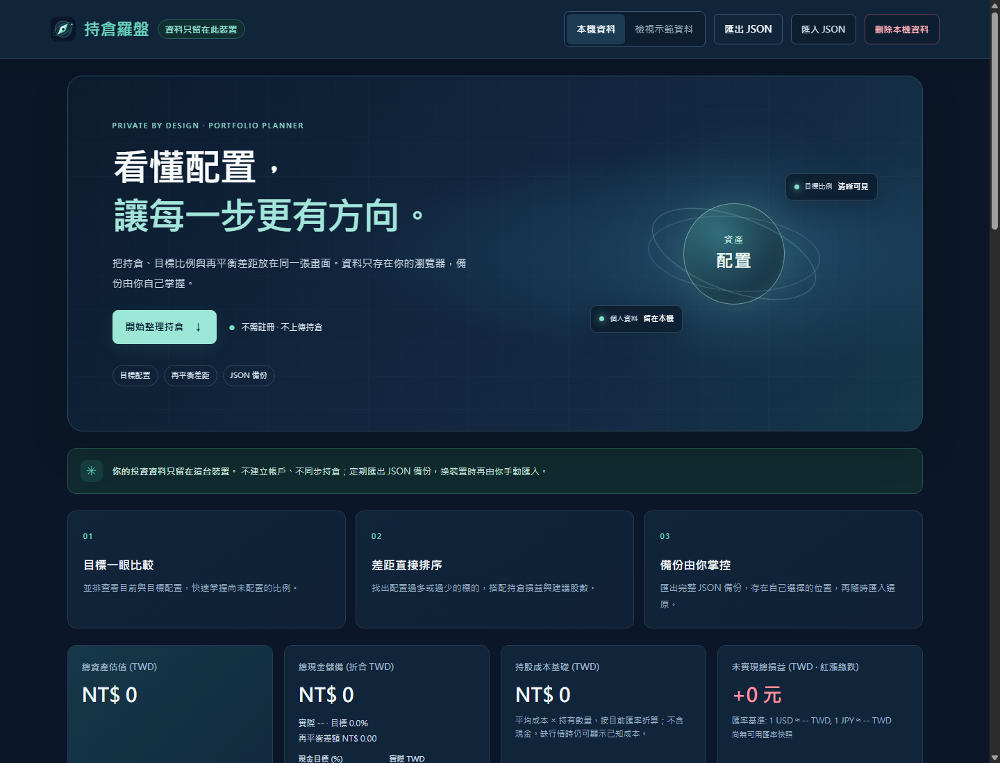

# 持倉羅盤 | Portfolio Compass

**看懂配置，讓每一步更有方向。**

免費、開源、本機優先的投資組合儀表板。整理台股、美股、日股與三幣別現金，在價格與匯率資料備齊後，以 TWD 對照目前與目標配置，將差距換算成整股試算。深海藍、薄荷綠與清楚的數字層級，讓注意力回到自己的配置計畫。

[立即試用線上版（GitHub Pages）](https://ricky5932tw.github.io/portfolio-compass/) ·
[觀看互動宣傳動畫](./public/promo/index.html) · [下載配音 MP4](./artifacts/promo.mp4) · [下載配音 WAV](./artifacts/promo-narration.wav)

動畫使用示意資料，非即時行情。啟動專案後，請在 `/promo/index.html` 開啟瀏覽器版；原始碼平台的 HTML 連結可能只會顯示檔案內容。



[檢視手機產品畫面](./artifacts/ui-mobile.png)

## 適合什麼時候使用

- **定期檢視配置**：比較目前權重與目標權重，辨識超配、低配及未配置比例。
- **整理跨市場部位**：手動彙整不同券商的持倉和現金，依可用價格與匯率折算為 TWD。
- **把計畫轉成試算**：輸入自己的成本、數量和長期目標價，查看配置差額與整股數。
- **先體驗再建檔**：點選 Demo 瀏覽範例配置；示範資料與本機持倉分開，無需建立帳戶。

## 核心功能

| 功能 | 目前提供的能力 |
| --- | --- |
| 四類市場 | 台灣上市 `TW`、台灣上櫃 `TWO`、美股 `US`、日股 `JP` |
| 三幣別現金 | `TWD`、`USD`、`JPY` 餘額與整體現金目標比例 |
| 配置對照 | 目前／目標配置圖、未配置比例及再平衡差額 |
| 整股試算 | 依配置差額與價格向下取整，顯示買入／賣出股數；買入藍色、賣出琥珀色 |
| 自訂資料 | 手動輸入平均成本、數量、目標權重、現價與日期；長期目標價為選填 |
| 每日歷史 | 本機每日資產總額與配置比例紀錄，以台北日期保存 |
| 備份與移轉 | JSON 匯出／匯入，匯入前驗證格式並確認覆寫 |
| 響應式介面 | 桌面資訊總覽、手機持倉卡片與表單 |

損益採台股常見的紅漲綠跌；買賣試算另以文字和藍／琥珀色辨識。整股試算不等於券商可直接執行的委託，仍須核對市場交易單位、可用資金、持股數量與費用。

## 快速開始

建議使用 Node.js 22（與專案 GitHub Actions 一致）。在專案目錄執行：

```powershell
npm.cmd ci
npm.cmd run dev
```

依終端機顯示的網址開啟網頁，預設為 `http://127.0.0.1:5173`。Windows 使用 `npm.cmd` 可避免 PowerShell 將 `npm` 解析為受執行原則限制的 `npm.ps1`；macOS／Linux 可使用 `npm`。

第一次使用可先點 Demo。建立自己的配置時，切回「本機資料」，新增持倉、設定現金，再於持倉卡片輸入市價與日期並套用。所有數值皆需由使用者自行核對。

## 行情與匯率的實際限制

**目前沒有自動行情或匯率服務，也不需要 API key。** 程式不會向行情 API 發送請求。

- **價格**：使用手動市價；若未設定，則使用匯入備份或既存快取中的報價。畫面會顯示來源與日期，超過三天的資料會標記過期；標記不會觸發更新。
- **匯率**：TWD 固定為 1；USD、JPY 使用備份／快取內的 `snapshot.fx`。目前介面沒有匯率輸入或更新功能。全新本機資料沒有外幣匯率，加入外幣持倉或現金後，需具備含有效匯率的 JSON 備份才能完成 TWD 估值。
- **資料不足**：缺少必要價格或匯率時，暫不計算總資產、完整配置差額及每日快照，避免用不完整資料呈現結果。
- **Demo**：價格與匯率為固定範例，僅供體驗；不會更新成市場數據，也不應用於實際買賣。

每日歷史只在「本機資料」模式、網頁開啟且估值資料完整時建立。同一天的資料會被最新快照取代；不會回填過去行情，也不是排程抓價服務。資產總額變化可能來自入金、出金或持倉編輯，不能直接視為投資報酬率。

## 資料與隱私

持倉、成本、數量、現金、報價快取與每日資產紀錄儲存在目前瀏覽器、目前網站來源的 `localStorage`。不含登入、雲端資料庫、同步服務、廣告或追蹤分析；應用程式不會把投資資料傳回網站主機。

**資料不會自動跨裝置或跨網址同步。** 更換瀏覽器、網域或連接埠也可能進入不同的儲存空間。清除網站資料、使用私密瀏覽或按下清除本機資料，都可能使紀錄消失。請定期備份；換裝置或網址前，先在舊頁面匯出 JSON，再於新頁面匯入。

JSON 備份未加密，可能包含完整持倉、成本、現金、行情快取及每日紀錄。請放在安全位置，勿上傳公開連結、issue 或聊天。匯入上限為 5 MB；通過格式驗證後仍需確認覆寫，確認後會取代目前本機資料。重要移轉前，請先保留一份原資料備份。

本機儲存不等於絕對安全；可存取此瀏覽器資料的人或軟體仍可能讀取內容。公開託管只提供靜態網頁，網站主機仍可能依其政策記錄一般連線資訊，例如 IP、時間與請求路徑；這些存取紀錄不含應用程式內的持倉內容。

另請閱讀[隱私與資料說明](./privacy.html)。

## 開發與驗證

```powershell
npm.cmd test
npm.cmd run build
npm.cmd run preview
```

`test` 執行既有 Vitest 測試；`build` 執行 TypeScript 檢查與 Vite 建置，輸出至 `dist/`；`preview` 啟動建置結果的本機預覽，預設為 `http://127.0.0.1:4173`。

修改介面後，另以真實瀏覽器檢查 360px、390px 與 1440px 寬度的空狀態、Demo、持倉表單及匯入／匯出流程。測試通過不代表已驗證即時行情或跨裝置同步，因為目前沒有這兩項服務。

## 宣傳動畫

瀏覽器版入口為 [`public/promo/index.html`](./public/promo/index.html)，成片為 [`artifacts/promo.mp4`](./artifacts/promo.mp4)。本機開發或部署後，以網站的 `/promo/index.html` 路徑觀看互動版；預設開發網址為 `http://127.0.0.1:5173/promo/index.html`。若部署於 GitHub Pages 專案子路徑，請在該專案網址後加上 `promo/index.html`。影片中的數字為示意資料，不代表投資績效或未來報酬。配音為 Microsoft Edge 線上神經語音 `zh-TW-YunJheNeural`，沒有背景音樂；互動播放器提供繁體中文字幕。

動畫來源為 [`scripts/promo_render.py`](./scripts/promo_render.py)。在專案目錄以 Python 重製：

```powershell
python -m pip install --target .promo-tools pillow imageio-ffmpeg
python scripts/promo_render.py
```

`promo_render.py` 會輸出 24 秒、1920×1080、24 fps 的無聲 H.264 畫面，產生五幕檢視圖 `artifacts/promo-contact-sheet.jpg`、網頁海報 `public/promo/poster.jpg` 與網頁播放副本。`promo_narration.py` 會把配音混入影片（保留既有畫面、不重新編碼），輸出 `artifacts/promo.mp4`、獨立 WAV、SRT 與 VTT 字幕；無聲成片保存在 `artifacts/promo-silent.mp4`。播放器字幕檔為 `public/promo/narration.zh-TW.vtt`。

首次合成需網路取得 Microsoft 線上語音，並安裝依賴：

```powershell
python -m pip install --target .promo-tools pillow imageio-ffmpeg edge-tts
python scripts/promo_render.py
python scripts/promo_narration.py --generate
```

若已快取語音片段，可離線重新混音：`python scripts/promo_narration.py`。完成後執行 `npm.cmd run build`，把更新後的 MP4 和字幕複製至發布目錄。

## 部署

線上版目前託管於[免費 GitHub Pages](https://ricky5932tw.github.io/portfolio-compass/)，適用於公開 repo 的 GitHub Free。本站是純靜態 Vite 網站；持倉留在使用者瀏覽器的本機儲存，不需要伺服器或資料庫。

GitHub Actions workflow [`pages.yml`](./.github/workflows/pages.yml) 已設定為推送 `main` 時自動執行測試、建置並發布 `dist/`；也可在 repository 的 **Actions → Build and deploy to GitHub Pages → Run workflow** 手動部署。部署結果與網站網址會顯示在該次 workflow 的 `deploy` job。GitHub Pages 僅對外提供靜態網頁，不會收到應用程式內的持倉資料。

若要在其他靜態主機部署，安裝依賴並執行 `npm.cmd run build`，再將 `dist/` 設為發布目錄；Linux 環境請使用 `npm ci`／`npm run build`。Vercel 或 Cloudflare Pages 可直接使用 Vite 建置設定。

`public/promo/` 會隨 Vite 建置複製到 `dist/promo/`，包含配音動畫與字幕；`artifacts/` 是交付素材目錄，不會自動發布至網站。部署後可使用 `/promo/promo.mp4` 提供影片下載。

## 使用邊界與產品方向

此工具用於整理持倉與試算配置差距，不提供即時行情、交易執行、個人化投資建議或報酬保證。請自行核對價格、匯率、交易單位及券商費用。長期目標價由使用者設定，並非系統預測。

目標用戶、品牌視覺與成長規劃請參閱[商業戰略與產品成長白皮書](./COMMERCIAL_STRATEGY.md)；其中的定位與行銷構想不代表目前已實作功能。此次製作需求見[藝術總監製作需求](./ART_DIRECTION.md)。

## License

[MIT](./LICENSE)
